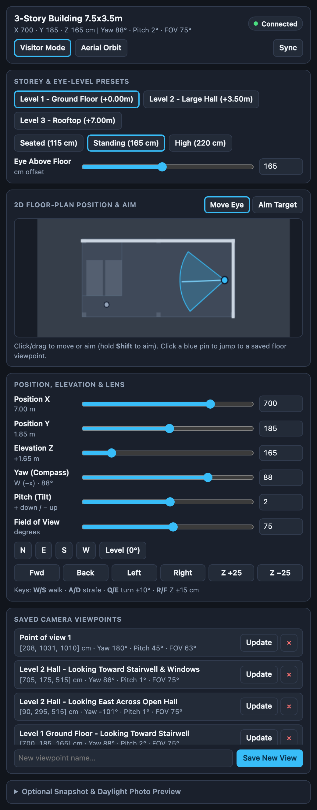
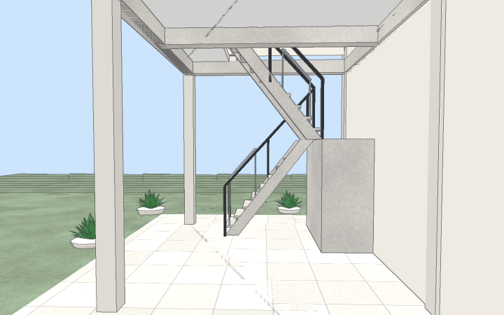
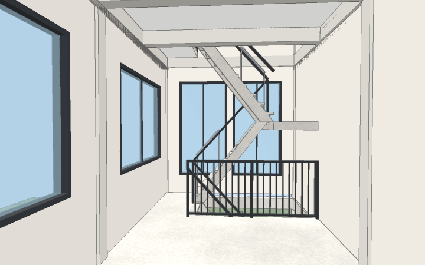

# Newera Camera Control Plugin

A lightweight native plugin for **[3D New Era AI](https://github.com/leandrodaf/3d-new-era-ai)** (`Plugins → Camera Control`) that opens a compact standalone companion window to control the live 3D visitor camera in real time—with zero external dependencies.

Instead of creating temporary "scratch" viewpoints while dragging sliders, it writes directly to Newera's active observer camera via the REST API (`POST /api/commands` with `set_cameras`), so Newera's 3D viewport follows smoothly as you move.

## Snapshots

### Companion Camera Control Window



### Example Standing Eye-Level Views Created & Controlled with the Plugin

| Level 1 — Ground Floor (`z = 165 cm`) | Level 2 — Large Hall (`z = 515 cm`) |
| :---: | :---: |
|  |  |

## Features

- **Live 3D Viewport Sync:** Dragging sliders or clicking the floor plan moves Newera's live 3D camera immediately without cluttering your saved viewpoints list.
- **Mode Toggle:** Switch between **Visitor Mode** (first-person eye view) and **Aerial Orbit** (bird's-eye overview) in one click.
- **Storey & Eye-Level Presets:** Jump to any floor in your project at **Seated (115 cm)**, **Standing (165 cm)**, **High (220 cm)**, or a custom height offset above the floor.
- **Interactive 2D Floor-Plan Mini-Map:** Click or drag anywhere on the floor plan to move the camera (`Move Eye`), hold **Shift** (or switch to `Aim Target`) to point the camera, or click a floor pin to jump straight to a saved viewpoint.
- **Position, Lens & Keyboard Walking:** Fine-tune `X`, `Y`, `Z`, `Yaw`, `Pitch`, and `FOV` (`25°–120°`), snap to `N / E / S / W` or level horizon (`0°`), nudge step-by-step, or walk with **`W / S / A / D`**, turn **`Q / E`**, and raise/lower **`R / F`**.
- **Saved Viewpoints Manager:** Jump to saved views, overwrite an existing view in place (`Update`), delete views, or save new ones.
- **Optional Previews:** Expand **Optional Snapshot & Daylight Photo Preview** whenever you want a quick software 3D snapshot or path-traced daylight render inside the companion window.
- **Auto-Shutdown:** Automatically shuts down its background helper 30 seconds after you close 3D New Era AI.

## Installation & Usage

### Prerequisites
- **3D New Era AI** desktop app
- **Node.js 18+** (built-in `fetch` support; zero `npm install` packages needed)
- *(Optional)* Google Chrome for the compact borderless `--app` window (falls back automatically to your default browser)

### Install into Newera's Plugin Folder

**macOS / Linux:**
```sh
mkdir -p ~/.config/3d-new-era-ai/plugins
git clone https://github.com/kadon-dev/newera-camera-plugin.git ~/.config/3d-new-era-ai/plugins/camera-control
chmod +x ~/.config/3d-new-era-ai/plugins/camera-control/launch.sh
```

> If you set `XDG_CONFIG_HOME` or `NEWERA_PLUGINS`, clone into `$XDG_CONFIG_HOME/3d-new-era-ai/plugins/camera-control` or one of your `NEWERA_PLUGINS` directories instead.

### Open Inside Newera
1. Launch **3D New Era AI**.
2. In the menu bar, click **Plugins → Camera Control**.
3. The standalone **Camera Control** window opens beside Newera and connects automatically.

### Optional Environment Variables
| Variable | Default | Purpose |
| :--- | :--- | :--- |
| `NEWERA_URL` | `http://127.0.0.1:7878` | Base URL of Newera's HTTP/MCP server (automatically passed by Newera when launched from the menu). |
| `NEWERA_TOKEN` | *(empty)* | Bearer token if your Newera server has authentication enabled. |
| `NEWERA_CAMERA_PORT` | `7889` | Local port used by the Camera Control companion UI server. |

---

## How Each File & Function Works (Simple Guide)

### `plugin.json`
The manifest file that tells Newera the plugin's ID (`camera-control`), menu label (`Camera Control`), tooltip description, and startup command (`./launch.sh`).

### `launch.sh`
A tiny shell wrapper so GUI-launched Newera on macOS/Linux can find Node.js even when `PATH` doesn't include Homebrew or version managers.

| Function | What It Does |
| :--- | :--- |
| `find_node()` | Searches `PATH`, Homebrew (`/opt/homebrew/bin/node`), `/usr/local/bin/node`, Volta, `asdf`, `fnm`, and `~/.nvm` for `node`, then runs `launcher.mjs`. |

### `launcher.mjs`
Starts (or reuses) the local companion server, opens the app window, and exits immediately so Newera never waits or times out.

| Function | What It Does |
| :--- | :--- |
| `fetchJsonWithTimeout(url, options, timeoutMs)` | Sends a quick HTTP request with a timeout and safely returns parsed JSON (or `null` if unavailable). |
| `ensureServer()` | Pings `http://127.0.0.1:7889/api/ping`. If already running, updates its Newera URL/token via `/api/reconfigure`; otherwise spawns `server.mjs` detached in the background and waits up to 4s until it responds. |
| `openWindow()` | Opens the UI in a compact Chrome `--app` window (`500×860`) if Chrome is installed, or falls back to the OS default browser (`open` on macOS, `cmd /c start` on Windows, `xdg-open` on Linux). |

### `server.mjs`
A zero-dependency Node HTTP bridge between the browser UI and Newera's REST + MCP endpoints.

#### Core Helper Functions
| Function | What It Does |
| :--- | :--- |
| `runSerialized(fn)` | Queues camera write actions one after another so fast slider drags never race or overwrite each other out of order. |
| `authHeaders(extra)` | Attaches `Authorization: Bearer <token>` to outgoing requests when `NEWERA_TOKEN` is configured. |
| `neweraFetch(path, options, timeoutMs)` | Calls Newera's local REST server with authentication and a timeout guard. |
| `getHome()` | Fetches the live project JSON (levels, walls, rooms, furniture, and cameras) from Newera's `GET /api/home`. |
| `applyCameras(mutatorFn)` | Reads the latest camera state, applies your change, sends a `set_cameras` command to `POST /api/commands`, and retries once automatically if Newera reports a concurrent edit (`409`). |
| `formatCameras(cameras)` | Converts Newera's `cameras` object into the UI format (`active` mode, current `observer`, and indexed `rows`). |
| `computeBuildingBounds(walls, rooms, furniture)` | Measures the bounding box from building walls and rooms (falling back to furniture) so large outdoor lawns don't shrink the 2D floor-plan mini-map. |
| `buildStatePayload(state, requestedLevelId)` | Filters walls, rooms, and architectural openings (windows, doors, stairs, railings, columns) for the chosen floor and packages everything for the UI. |
| `rawMcpPost(...)` / `ensureMcpSession()` / `callMcpTool(...)` | Minimal MCP JSON-RPC client used **only** for optional on-demand 3D snapshots (`render_3d`) and daylight photo renders (`render_photo`). |
| `extractImageDataUrl(content)` | Pulls a PNG image out of an MCP render reply and turns it into a browser-ready `data:` URL. |
| `parseCamPose(body)` | Validates numeric camera values (`x`, `y`, `z`, `yaw`, `pitch`, `fov`), rounds to 1 decimal place, and clamps FOV to `25°–120°`. |
| `readJsonBody(req)` / `sendJson(res, status, data)` | Safely reads JSON request bodies (up to 1 MB) and sends `no-store` JSON responses. |
| `healthWatcher` (`setInterval`) | Checks Newera's `/health` every 10 seconds and exits `server.mjs` cleanly after 3 failed checks (30 seconds after Newera closes). |

#### Companion Server Endpoints
| Route | What It Does |
| :--- | :--- |
| `GET /` (or `/index.html`) | Serves the `index.html` Camera Control interface. |
| `GET /api/ping` | Health check returning `{ ok, neweraUrl, pid }` so `launcher.mjs` knows the server is ready. |
| `POST /api/reconfigure` | Updates `neweraUrl` / `neweraToken` if Newera restarted on another port or token. |
| `GET /api/state?level=...` | Returns project name, bounds, levels, filtered 2D floor plan, and camera list. |
| `GET /api/events` | Proxies Newera's SSE `/api/events` stream so the UI notices edits made directly inside Newera. |
| `POST /api/camera/live` | Updates Newera's active `observer` pose in real time (without creating a scratch saved viewpoint). |
| `POST /api/camera/select` | Switches to **Aerial Orbit** (`{ mode: "aerial" }`) or jumps to saved viewpoint `i`. |
| `POST /api/camera/save` | Saves a new viewpoint or overwrites an existing one in place (`overwriteIndex`). |
| `POST /api/camera/delete` | Deletes saved viewpoint `i`. |
| `POST /api/camera/preview` | Renders an optional 3D snapshot (`render_3d`) via MCP. |
| `POST /api/camera/photo` | Renders an optional sunlit path-traced photo (`render_photo`) via MCP. |

### `index.html`
Self-contained UI with light/dark theme support, 2D floor-plan canvas, sliders, keyboard walking, and live SSE sync.

| Function | What It Does |
| :--- | :--- |
| `updateRangeProgressFallback(rangeEl)` | Updates a CSS `--progress` variable on range sliders for browsers that don't support `accent-color`. |
| `setStatus(text, kind)` / `showError(msg)` | Updates the top-right status pill (`Connected`, `Live`, `Offline`, `Error`) and shows or hides error messages. |
| `compassLabel(yaw)` | Translates a numeric yaw angle into a compass direction (`N`, `NE`, `E`, `SE`, `S`, `SW`, `W`, `NW`). |
| `currentFloorForZ(z)` | Finds which building storey corresponds to the camera's current `Z` elevation. |
| `syncControlsFromState()` | Syncs all sliders, number fields, meter labels, active mode/floor/eye-height buttons, and triggers a map redraw. |
| `renderLevelChips()` / `renderCameraList()` | Renders the clickable storey buttons and the saved viewpoints list (with `Update` and `×` delete buttons). |
| `getMapTransform(canvas)` / `floorSavedPins()` / `drawPlanMap()` | Maps world centimeters to canvas pixels and draws rooms, openings, walls, saved camera pins on the current floor, the camera eye dot, and its FOV cone. |
| `updateImagePreview(dataUrl)` | Displays the rendered 3D snapshot or daylight photo inside the collapsible preview box. |
| `loadProjectState(levelId, syncCamFromActive)` | Loads `/api/state` and updates slider ranges, floor geometry, levels, and camera values. |
| `scheduleLiveUpdate(immediate)` / `flushLiveUpdate()` | Debounces rapid slider/map inputs (`50 ms`) and sends camera updates sequentially to `/api/camera/live`. |
| `selectSavedCamera(row)` / `saveCurrentView(name, overwriteIndex)` / `deleteSavedCamera(idx)` | Activates a saved viewpoint, saves/overwrites a viewpoint, or deletes one via the server API. |
| `bindSliderPair(rId, nId, key, onChangeExtra)` | Keeps each slider and its paired number input synchronized and tracks active dragging. |
| `applyMapPointer(ev, isDown)` | Handles clicking/dragging on the 2D mini-map to move the camera, aim (`Shift` or Aim mode), or click a saved pin. |
| `walkStep(fwdCm, rightCm, upCm)` | Moves the camera relative to its current facing angle (used by nudge buttons and `W/S/A/D/R/F` keys). |
| `connectEvents()` | Connects to `/api/events` (SSE) to refresh the UI when Newera changes externally, skipping refreshes while dragging. |

## Project Structure

```text
camera-control/
├── plugin.json        # Newera plugin manifest
├── launch.sh          # Portable Node.js finder & launcher
├── launcher.mjs       # Starts/reuses server.mjs and opens the standalone window
├── server.mjs         # REST + SSE + optional MCP bridge with auto-shutdown
├── index.html         # Companion Camera Control web UI
├── README.md          # Documentation and snapshots
└── docs/
    └── snapshots/
        ├── camera-control-ui.png
        ├── view-level1-ground-floor.png
        └── view-level2-hall.png
```
